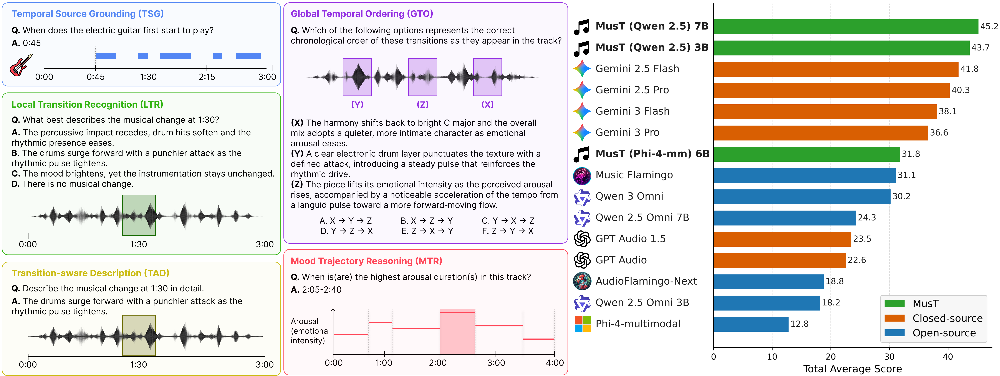

<h1>MusTBench: Benchmarking and Advancing Temporal Grounding in Music LLMs</h1>

<p align="center">
  <a href="https://arxiv.org/abs/2605.29300">
    
  </a>
  <a href="https://daeyongkwon98.github.io/mustbench">
    
  </a>
  <a href="">
    
  </a>
</p>

<p align="center">
  
</p>

**MusTBench** is a benchmark for evaluating temporal grounding in Large
Audio-Language Models (LALMs). It evaluates whether a model can identify,
describe, order, and localize temporally situated musical events.

MusTBench contains **1,264 question-answer examples** over **875 unique audio
tracks** and consists of five tasks:

| Task | Full name | Output | QA examples |
| --- | --- | --- | ---: |
| **TSG** | Temporal Source Grounding | Timestamp (`M:SS`) | 400 |
| **LTR** | Local Timestamp Reasoning | Multiple-choice answer (`A`-`D`) | 208 |
| **TAD** | Timestamp-Aware Description | Free-form transition description | 208 |
| **GTO** | Global Transition Ordering | Multiple-choice answer (`A`-`F`) | 198 |
| **MTR** | Music Temporal Region Grounding | One or more intervals (`M:SS-M:SS`) | 250 |

## Installation

Clone the repository:

```bash
git clone https://github.com/sony/MusTBench.git
cd MusTBench
```

Create a Python 3.10 conda environment with `ffmpeg`, then install the pinned
CUDA 12.8 Python dependencies:

```bash
conda create -n mustbench -c conda-forge python=3.10 pip ffmpeg -y
conda activate mustbench
python -m pip install --upgrade pip
python -m pip install -r requirements.txt
```

The inference code was tested with Python 3.10, PyTorch 2.9.0, Transformers
4.57.1, Accelerate 1.10.1, and CUDA 12.8 wheels. A recent NVIDIA driver
compatible with CUDA 12.8 is required for GPU inference and CLAP evaluation.

## Benchmark Data

The benchmark is provided as a unified Parquet file:

```text
benchmarks/mustbench.parquet
```

Each row corresponds to one QA example.

### Schema

| Column | Description |
| --- | --- |
| `id` | Unique QA example ID |
| `track_id` | Audio track identifier |
| `task` | Task type: `TSG`, `LTR`, `TAD`, `GTO`, or `MTR` |
| `category` | Category information for TSG; null for other tasks |
| `qa_type` | QA subtype for TSG; null for other tasks |
| `question` | Question text |
| `answer` | Canonical answer for single-answer tasks |
| `answers` | List of reference answers; for MTR, this can contain multiple reference intervals |
| `split` | Dataset split |

### Load the Local Parquet File

```python
import pandas as pd

benchmark = pd.read_parquet("benchmarks/mustbench.parquet")
print(benchmark)
print(benchmark.iloc[0])

tsg = benchmark[benchmark["task"] == "TSG"]
```

### Load from Hugging Face

TBD

<!-- ```python
from datasets import load_dataset

dataset = load_dataset("qiyuwww/mustbench", split="test")
print(dataset)
print(dataset[0])
``` -->

## Source Audio

This repository distributes MusTBench annotations and QA data, but **does not
redistribute the associated audio files**.

The benchmark uses tracks from:

- [Slakh2100](https://zenodo.org/records/4599666)
- [MTG-Jamendo](https://mtg.github.io/mtg-jamendo-dataset/)

Download both datasets from their original providers and comply with their
respective licenses and access conditions.

The 875 required tracks consist of:

| Source dataset | Track ID format | Tracks | Collected format |
| --- | --- | ---: | --- |
| MTG-Jamendo | Numeric ID, e.g. `1001315` | 749 | MP3 |
| Slakh2100 | `Track` followed by five digits, e.g. `Track01876` | 126 | FLAC |

## Preparing the Audio Files

`code/collect_audios.py` reads all unique `track_id` values from the benchmark,
finds the corresponding files in downloaded MTG-Jamendo and Slakh2100
directories, and copies only the 875 required tracks into one flat directory.

Run the collector after downloading both source datasets:

```bash
python code/collect_audios.py \
  --benchmark-path benchmarks/mustbench.parquet \
  --mtg-root-path /absolute/path/to/mtg-jamendo \
  --slakh-root-path /absolute/path/to/slakh2100 \
  --output-dir audios
```

The resulting directory is flat:

```text
audios/
├── 1001315.mp3
├── 1002010.mp3
├── ...
├── Track01876.flac
└── ...
```

Existing byte-identical destination files are skipped. A differing destination
file causes an error unless `--overwrite` is supplied. Unrelated MP3 or FLAC
files in the output directory cause an error unless `--allow-extra-audio` is
supplied.

## Inference

The provided inference pipeline runs
[`Qwen/Qwen2.5-Omni-7B`](https://huggingface.co/Qwen/Qwen2.5-Omni-7B) through
Hugging Face Transformers.

Run all commands from the repository root.

```bash
python code/inference.py \
  --benchmark-path benchmarks/mustbench.parquet \
  --audio-root audios \
  --output-path results/mustbench_qwen25_omni_predictions.json \
  --model-id Qwen/Qwen2.5-Omni-7B \
  --device-map auto \
  --torch-dtype bfloat16 \
  --batch-size 1 \
  --save-every 20 \
  --continue-on-generation-error
```

To evaluate selected tasks, add an option such as `--tasks TSG MTR`.

Rerunning the same command with the same `--output-path` resumes an
interrupted run and skips completed examples.

Predictions are saved as JSON with the original benchmark fields, model
response, parsed prediction, references, and parse status.

## Evaluation

After inference is complete, evaluate the prediction JSON with:

```bash
python code/evaluate.py \
  results/mustbench_qwen25_omni_predictions.json \
  --audio-root audios \
  --clap-device cuda
```

The evaluator reports the following metrics:

| Type | Task | Metric | Definition |
| --- | --- | --- | --- |
| **Type1** | TSG | Hit@3s | Fraction of predicted timestamps within 3 seconds of a reference timestamp |
| **Type2** | LTR | Accuracy | Exact accuracy of the predicted multiple-choice option |
| **Type3** | TAD | METEOR | Exact-token METEOR between the generated and reference transition descriptions |
| **Type3** | TAD | CLAPScore | Cosine similarity between the generated text and the CLAP audio embedding for the `T-10s` to `T+10s` clip around the queried timestamp |
| **Type4** | GTO | Accuracy | Exact accuracy of the predicted chronological-order option |
| **Type5** | MTR | Macro Temporal IoU | Mean per-example intersection-over-union of the predicted and reference interval sets |
| **Type5** | MTR | Macro Temporal F1 | Mean per-example harmonic mean of temporal precision and temporal recall |

By default, the evaluator writes:

```text
results/mustbench_qwen25_omni_evaluation.json
results/mustbench_qwen25_omni_evaluation_rows.json
```

The first file contains aggregate metrics, while the second contains
per-example scores and parsed predictions. Use `--skip-clap` to evaluate all
other metrics without loading the CLAP model.

## Citation

If you use MusTBench in your research, please cite:

```bibtex
@article{kwon2026MusTBench,
  title={MusTBench: Benchmarking and Advancing Temporal Grounding in Music LLMs},
  author={Kwon, Daeyong and Wu, Qiyu and Kuriya, Shinobu and Koo, Junghyun and Cui, Shuyang and Zhong, Zhi and Liao, Wei-Hsiang and Wakaki, Hiromi and Mitsufuji, Yuki},
  journal={arXiv preprint arXiv:2605.29300},
  year={2026}
}
```

## Acknowledgements

MusTBench builds on audio from Slakh2100 and MTG-Jamendo. We thank the authors
and maintainers of these datasets and the developers of the open-source models
and libraries used by this project.
